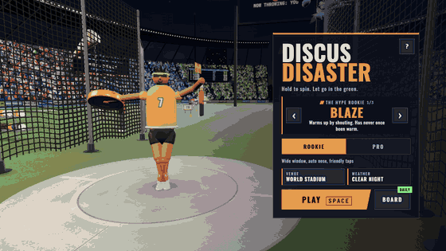
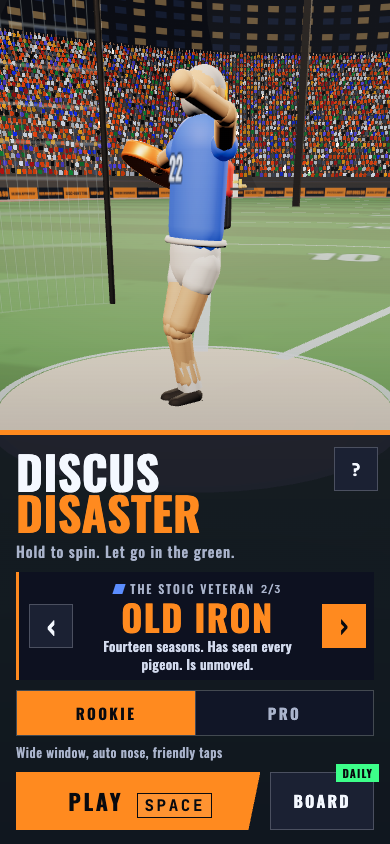
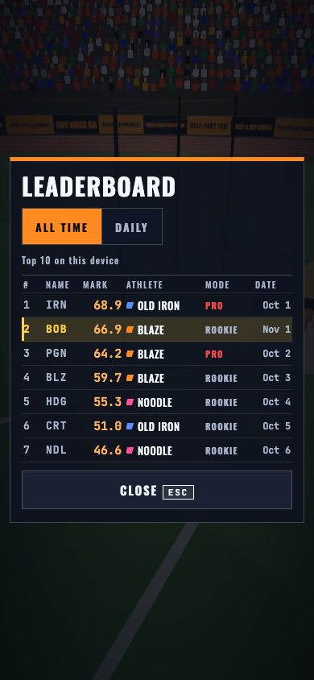
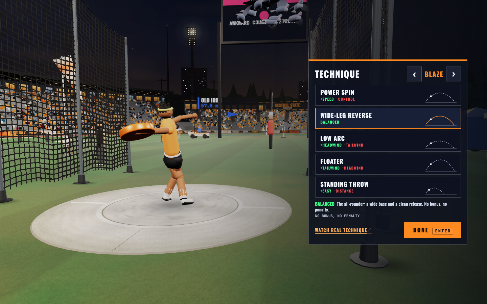
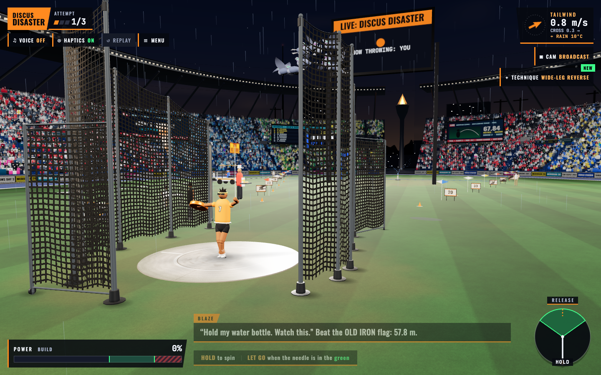
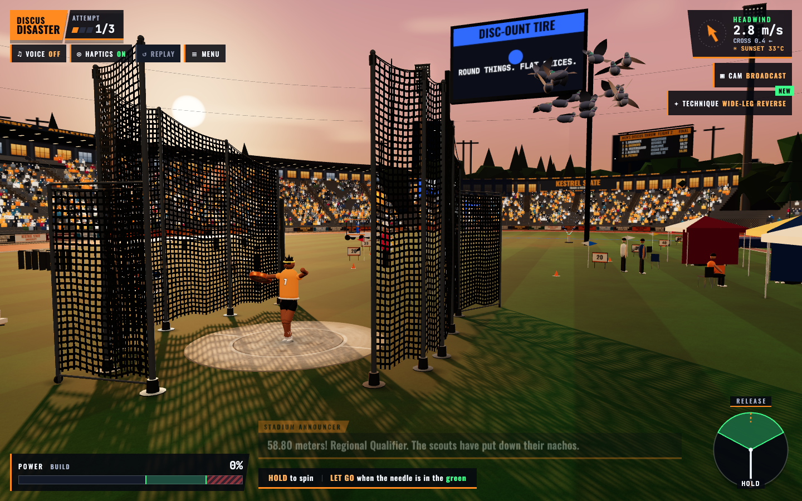
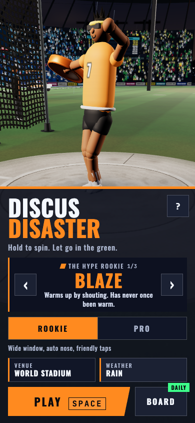
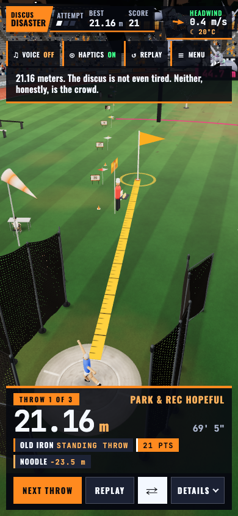

<p align="center"><a href="https://discus-disaster.vercel.app"><b>▶ PLAY NOW: discus-disaster.vercel.app</b></a></p>

<p align="center"></p>

**A funny, physically serious 3D browser game. Throw a real-aerodynamics discus under the floodlights, read the wind, and try not to hit the pigeons. (Hit the pigeons.)**

> **v3 adds** (details below): five **camera** views (`C`), five original **throwing techniques** with an animated picker, a **charge meter** with a sweet spot and honest overcharge, **change athlete** between throws, a second venue (the **World Championships Stadium**, a 360-degree bowl) and **weather** (clear, breezy, rain, fog, hot sunset, random; the Daily Throw gets the date's weather).
>
> **v2 in one breath**
> - **One action:** hold to spin, let go when the needle is in the green. That is the whole game in **Rookie** mode (wide window, auto nose, friendly taps). Switch to **Pro** for the original, unforgiving version.
> - **Pick an athlete** (BLAZE the hype rookie, OLD IRON the stoic veteran, NOODLE the chaotic walk-on) and **beat the rival flag** on the pitch.
> - **Leaderboard:** arcade initials, local top 10, plus a **Daily Throw** (same wind and cast for everyone that day) with a one-tap **Copy result**.
> - **Run it:** `git clone https://github.com/Waleee7/discus-disaster.git && cd discus-disaster && python3 -m http.server 8137`, open <http://localhost:8137>.

Built by a real college discus thrower who also writes software. No build step, no install, no CDN: Three.js is vendored in `vendor/`.

<p align="center"></p>
<p align="center">  </p>
<p align="center"> </p>
<p align="center">  </p>
<p align="center"><sub>The GIF is a <b>staged</b> throw in the World Championships Stadium (venue pick, a real PLAY click, the technique picker, then a key hold), but a hand-picked wind/obstacle seed and a pinned obstacle clock so the pigeon pass lines up, recorded as a time-lapse to stay under 2.5 MB. Your own throws will be messier.</sub></p>

## Real kit (art pass)

Green-screen sheets generated in Google Flow live in `art-src/`. `node scripts/build-art.mjs` keys them into `art/*.webp` and `src/artAtlas.js`, and [`src/cards.js`](src/cards.js) draws them as camera-facing cards in one draw call per sheet. So far: real rock pigeons with a wing-flap flipbook and a feather burst, a hot dog cart with three views, a wrecked state and flying hot dogs, cones, sector markers, a total station, a prism pole, a judge's chair, and a flag judge who raises white for a fair throw and red for a foul. The code also got a see-through 6 cm cage net, galvanised posts, and a closer-to-real steel-rim discus. Physics and scoring are untouched.

## How it plays

| | **Rookie** (default) | **Pro** |
|---|---|---|
| Green release window | 124 deg on throw 1, 112, then 100 (Pro is 80) | 80 deg |
| Needle in the green | eases down so you can react | full speed |
| Nose angle | auto-set for your release and the wind (drag to take over) | yours, always |
| Instant tap / release behind you | a short, legal toss | cage foul |
| After a foul | one coaching line: *Let go when the needle is in the green.* | none |
| Physics, top speed, power curve | **identical** | identical |

A perfect release at full power (~3 turns) is about **66 m in Pro** (the real record is 74.35 m). Rookie keeps the same physics and the same top speed; it only forgives the human part, and a simulated "average first-timer" lands **45-65 m within three throws** (unit-tested). The choice is remembered (`localStorage`, optional: everything works with storage blocked).

**Characters.** Three original, fictional athletes built from primitives (capsule limbs, jersey numbers, headband, shades, hair): they differ in colours and personality, and the next one in the carousel is your **rival**. A flag and a line across the sector mark the rival's best mark; the result card tells you by how much you beat it.

**Leaderboard.** Finish three throws and a qualifying mark asks for **3 initials** (arcade wheels, or just type). The board shows mark, athlete, mode and date, is seeded with fictional regulars so it is never empty, and lives in `localStorage` only. **Daily Throw** (BOARD > DAILY > PLAY TODAY'S THROW): the wind and cast phases come from the date, so everyone gets the same day; it has its own board and a share line like `DISCUS DISASTER daily · 61.2 m · Rookie · discus-disaster.vercel.app`. The board is one module, [`src/leaderboard.js`](src/leaderboard.js), behind a two-method adapter (`list`, `add`): a global backend is a new adapter, nothing else changes. There is no network code and no secret in this repo.

## v3: camera, techniques, power, venues, weather

**Camera** (`C`, gamepad `Y`, or the CAM button; ready, spin, flight and replay). Broadcast (the original), Behind circle (fixed, zooms down the sector), Side line, Discus cam (rides just behind the disc), Overhead. Switches glide (and cut under `prefers-reduced-motion`), the choice is remembered, and a small net-collision test ([`src/camera.js`](src/camera.js), same cage geometry as the scenery) nudges a shot around the athlete so a net never fills the lens. The rear cage gate is now small and folded back along the net.

**Techniques** (`T` or the TECHNIQUE button, before each throw). Five original, generic styles, each performed by your in-game athlete in the picker, each mapped to real inputs (release speed, release angle, nose, green window, turns to full power):

| Technique | What it does |
|---|---|
| Wide-Leg Reverse | the neutral all-rounder (Pro perfect release ~66 m) |
| Power Spin | a little more speed, needs more turns, small shaky green |
| Low Arc | flatter and faster: gains into a **headwind**, loses in a tailwind |
| Floater | nose up, higher hang: gains in a **tailwind**, loses into a headwind |
| Standing Throw | slow and short (~42 m) but the widest green by far: the most forgiving |

(The wind notes follow this simulator: a flat fast throw is best into a headwind, a higher nose pays off in a tailwind; the brief had them the other way round.) A "Watch real technique" link opens World Athletics' discus page in a new tab. No real athletes, photos or video are used.

**Power** is a charge meter: BUILD, then a green **SWEET SPOT** band (full power, accurate), then **OVERCHARGE**: the green window shrinks and the needle shakes, so a late release lands wider instead of just fouling. Only 5 turns steps out of the circle. Rookie keeps a later, gentler overcharge.

**Change athlete** (`P` or the arrows button on the result card / picker): the rival flag follows.

**Venues and weather** (start screen). *College Night Meet* (the original) or *World Championships Stadium*: two raked tiers, a roof ring with a lamp rim, fan blocks with waving flags, an LED ribbon, giant video boards, a results board, a camera rail and an open ceremonial end with a flame tower (fictional "Meridian Games": no rings, event names, sponsors or logos). Weather changes the throw honestly: **wind** range and **gusts** (Breezy), **air density** from the temperature (hot air = thinner = a little less lift *and* drag), and **rain** narrows the green (a slippery circle; the aerodynamics are untouched). Fog, rain, sun and a wet track are looks only. Wind, weather and temperature sit in the wind badge. Clear Night reproduces the original winds exactly.

## Controls

| Action | Keyboard | Mouse / Touch | Gamepad |
|---|---|---|---|
| Spin | hold `Space` / `Enter` | hold left button / hold anywhere | hold `A` or `RT` |
| Release | let go | let go / lift finger | let go |
| Nose angle (optional in Rookie) | `W`/`S` or `Up`/`Down` | drag up / down while holding | left stick / D-pad |
| Skip the landing beat | any press during flight | tap | `A` |
| Menu (athlete, mode, board) | `Esc` | MENU button | |
| Camera / technique / athlete | `C` / `T` / `P` | CAM, TECHNIQUE, the arrows button | `Y` |
| Replay best / voice / haptics / help | `R` / `M` / `H` / `?` | toolbar, `?` on the start card | `X` / `Back` / `LB` |

## Scoring

- **Distance** is measured from the edge of the 2.5 m circle to the landing mark; it must land inside the 34.9 degree sector and you must stay in the circle. Fouls score nothing.
- **Best of 3** sets your rank, from *Park & Rec Hopeful* up to *World Record Menace*.
- **Points** = distance x multiplier. Pigeon x1.5, sprinkler x1.25, hot-dog vendor x2, coach cart x2.5, jumbotron x3, capped.
- Power builds with every turn (full at about 3 turns, dizzy after 4, stepped out after 5). The dial angle at release sets heading and release angle (early = low and right, late = high and left).

## The physics is real

Flight lives in [`src/physics.js`](src/physics.js): a pure, DOM-free, deterministic module (RK4 at a fixed 1/240 s step). A 2 kg, 221 mm discus with gravity, air density from temperature and altitude, and wind (head, tail, cross).

```
q = 1/2 * rho * |v - wind|^2
drag D = q * A * C_D(alpha)       (opposes the air-relative velocity)
lift L = q * A * C_L(alpha)       (perpendicular to it, in the plane of velocity and disc normal)
alpha  = angle of attack = attitude angle - flight path angle (no wind)
```

`C_L(alpha)` and `C_D(alpha)` are **approximations** shaped like published discus data (low-aspect-ratio wing, stall near 25 degrees, then flat-plate behaviour), following the qualitative shape in Frohlich (1981), *Am. J. Phys.* 49, and Hubbard & Cheng (2007), *J. Biomech.* 40; the numbers are not copied from those papers. The disc keeps a fixed attitude in flight (no precession).

**The headwind quirk.** Lift grows with airspeed squared, so a well-set nose angle makes the discus fly **farther** into a breeze (and a tailwind costs distance). After each throw the game re-simulates your release in still air and tells you the gain, plus the nose angle your coach would have picked (Rookie sets that nose for you). Real benchmark: men's WR **74.35 m**, Mykolas Alekna, 2024 (a reference, not a claim about this model).

## Also in the box

3D night stadium (all procedural), broadcast camera with a short slow-mo landing and best-throw replay, a lower-third announcer with optional Web Speech voice, the cast (pigeon flock, coach's golf cart, hot-dog vendor, sprinkler, jumbotron), haptics (`navigator.vibrate` + gamepad rumble), keyboard-playable UI with visible focus, `prefers-reduced-motion` support. Page weight about 1.5 MB, fully offline once loaded; only the optional webfont is external. **Tested:** Chromium (Playwright) at 1440x900 and, with touch emulation, 390x844, 844x390 and 667x375. Firefox and Safari should work but are untested, as are real-device touch and haptics.

## Tests

```bash
npm test                      # unit tests + browser smoke test
node tests/smoke.mjs --docs   # same, and refreshes the committed docs/shots/
node scripts/record-gif.mjs   # regenerates docs/gameplay.gif and docs/screenshot.png (needs ffmpeg)
```

<details>
<summary>What the tests check</summary>

- `node --test tests/` (Node 18+): physics (vacuum range vs analytic, headwind beats still air, stall, determinism, perfect-throw calibration sweeps), the announcer, **modes** (Pro mapping unchanged; Rookie's assist lands farther and is legal more often than Pro at the same mid-quality release; a simulated average rookie lands 45-65 m within 3 throws; the tap is a short legal toss), and the **leaderboard** (seeded, sorted, top 10, validation, works with storage blocked or corrupt, a fake remote adapter plugs in, daily seed and share text).
- **v3 tests** (`tests/techniques.test.mjs`): every technique moves speed / angle / nose / window the intended way, Standing Throw is the most forgiving, techniques stay realistic (medians, no record-breakers), the charge zones and overcharge, camera net collision, hot air < cold air, a headwind still helps in every weather, rain narrows the window, each preset's wind range, gusts, the Daily weather.
- `node tests/smoke.mjs` (Playwright) at 1440x900, 390x844, 844x390 and 667x375 through the real input path: start screen, athlete carousel, mode toggle and PLAY click; a human-style throw; Pro's instant tap and a poisoned release; Rookie's tap, slower needle, auto nose, PERFECT flash and coaching line; press-to-skip; initials entry (typed and wheels), board, Daily tab and share text; plus, per viewport, the camera cycle (key C, flight, replay, reduced motion), athlete swap, technique picker (44 px targets, link, no overlap), charge-meter zones, and the venue + weather pickers; plus layout assertions on every screen (finite camera, 44 px targets, 11 px text, nothing overlapping, everything inside the viewport, athlete visible beside the start card).
- It expects Playwright at `$HOME/.claude/scripts/node_modules/playwright`; edit the `require` path if yours lives elsewhere.

</details>

## Tech and credits

Three.js r160 vendored in `vendor/`, import map, vanilla JS modules, CSS, Oswald + JetBrains Mono. Static files only: `index.html`, `src/*.js`, `src/style.css`. Pure modules (`physics`, `tuning`, `modes`, `personas`, `leaderboard`, `storage`) have no DOM, so Node tests import them directly; a `window.__debug` hook drives the deterministic captures.

Game, physics and jokes by Josh Dare. Characters are original and fictional. WR reference: World Athletics. No real pigeons were thrown at. MIT licensed, see [LICENSE](LICENSE); Three.js is MIT, see `vendor/three.LICENSE`.
