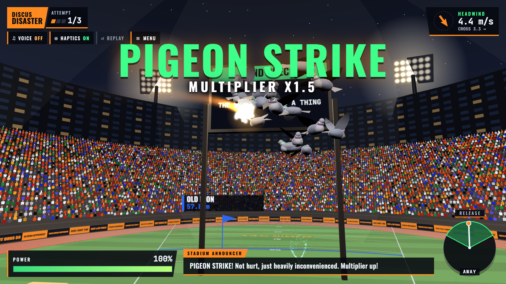
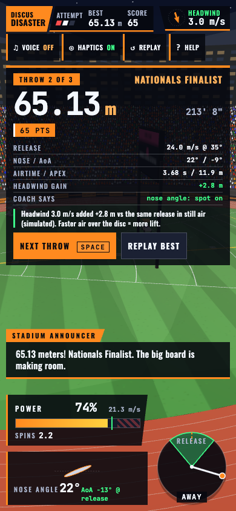

<p align="center"></p>

<p align="center"><a href="https://discus-disaster.vercel.app"><b>▶ PLAY NOW: discus-disaster.vercel.app</b></a></p>

**A funny, physically serious 3D browser game. Throw a real-aerodynamics discus under the floodlights, read the wind, and try not to hit the pigeons. (Hit the pigeons.)**

> **TL;DR**
> - **Hold** (Space / mouse / touch) to spin, **let go** as the needle crosses the green, **drag up/down** (or `W`/`S`) to set the nose angle.
> - **The headwind trick:** a headwind adds lift, so a well-set nose angle flies *farther* into a breeze (and a tailwind costs distance).
> - **Run it:** `git clone https://github.com/Waleee7/discus-disaster.git && cd discus-disaster && python3 -m http.server 8137`, then open <http://localhost:8137>.
> - 3 throws, best mark ranks you, hitting the cast multiplies your points. Play it in your browser at **[discus-disaster.vercel.app](https://discus-disaster.vercel.app)**, or run it locally in one command.

Built by a real college discus thrower who also writes software. No build step, no install, no CDN: Three.js is vendored in `vendor/`.

<p align="center"></p>
<p align="center"> </p>
<p align="center"><sub>The GIF is a <b>staged</b> throw: a real key hold and release, but a hand-picked wind/obstacle seed and a pinned obstacle clock so the pigeon pass lines up, recorded as a 2x time-lapse to stay under 2.5 MB. Your own throws will be messier.</sub></p>

## Play it locally

```bash
git clone https://github.com/Waleee7/discus-disaster.git
cd discus-disaster
python3 -m http.server 8137      # any static server works
# open http://localhost:8137
```

Needs a browser with WebGL2. **Tested: Chromium (Playwright) at desktop 1440x900 and, with touch emulation, phone portrait 390x844 and phone landscape 844x390 / 667x375.** Firefox, Safari and Edge should work (standard ES modules, WebGL2, Pointer Events) but are untested, and real-device touch and haptics have not been tested at all.

**Page weight and offline.** About 1.5 MB decoded on first load: `vendor/three.module.js` (Three.js r160, MIT, 1.27 MB raw, about 260 KB gzipped by most static hosts) plus roughly 170 KB of game JS/CSS. It is served from the repo, so the game runs with no network. The only external request is the optional Oswald / JetBrains Mono webfont from Google Fonts (about 60 KB); if it is blocked or you are offline the HUD falls back to `Arial Narrow` / `Impact` and the system monospace stack, and nothing breaks. (Opened from `file://` browsers block ES modules, so use any static server.)

## Controls

| Action | Keyboard | Mouse / Touch | Gamepad |
|---|---|---|---|
| Spin | hold `Space` / `Enter` | hold left button / hold anywhere | hold `A` or `RT` |
| Release | let go | let go / lift finger | let go |
| Nose angle | `W`/`S` or `Up`/`Down` | drag up / down while holding | left stick / D-pad |
| Skip the landing beat | `Space` (any press during flight) | tap | `A` |
| Replay best | `R` | toolbar button | `X` |
| Voice / haptics / help / next | `M` / `H` / `?` / `N` | toolbar buttons | `Back` voice, `Y` help, `Start` next |

## How to score

- **Distance** is measured from the edge of the 2.5 m circle to the landing mark; it must land inside the 34.9 degree sector and you must stay in the circle. Fouls score nothing.
- **Best of 3** sets your rank, from *Park & Rec Hopeful* up to *World Record Menace* (the real record is 74.35 m).
- **Points** = distance x multiplier. Pigeon x1.5, sprinkler x1.25, hot-dog vendor x2, coach cart x2.5, jumbotron x3, capped.
- **Timing:** power builds with every turn (full at about 3 turns, dizzy after 4, stepped out after 5). The needle crosses the green once per turn; dial angle sets heading and release angle (early = low and right, late = high and left).
- The controls take about a minute to learn; the nose angle and the wind take a few throws, and the post-throw readout shows what your coach would have set.

## The physics is real

Flight lives in [`src/physics.js`](src/physics.js): a pure, DOM-free, deterministic module (RK4 at a fixed 1/240 s step). A 2 kg, 221 mm discus with gravity, air density from temperature and altitude, and wind (head, tail, cross).

```
q = 1/2 * rho * |v - wind|^2
drag D = q * A * C_D(alpha)       (opposes the air-relative velocity)
lift L = q * A * C_L(alpha)       (perpendicular to it, in the plane of velocity and disc normal)
alpha  = angle of attack = attitude angle - flight path angle (no wind)
```

`C_L(alpha)` and `C_D(alpha)` are **approximations** shaped like published discus data (low-aspect-ratio wing: lift slope ~1.6 per radian, small lift at zero angle from the dished profile, quadratic drag growth, stall near 25 degrees, then flat-plate behaviour). They follow the qualitative shape in Frohlich (1981), *Aerodynamic and mechanical forces in discus flight*, Am. J. Phys. 49, and Hubbard & Cheng (2007), *Optimal discus trajectories*, J. Biomech. 40, but the numbers are not copied from those papers. Simplifications: the disc keeps a fixed attitude in flight (gyroscopic stability), there is no pitching moment or precession, and crosswind uses a small roll-bank gain so the disc actually drifts.

**Tuning.** Full power is 24.6 m/s. A *perfect* throw (dial centred, sensible nose angle) lands about 66 m in still air and about 67 m across the game's random winds; 72 m or more happens in roughly 1 in 100 perfect throws, and the 74.35 m world record needs a perfect throw, a strong headwind and a lucky bounce off the cast (`tests/physics.test.mjs` sweeps perfect throws in still air and in random wind and checks median and tail). A 3-4 m/s headwind adds roughly 2.5-3.5 m.

**The headwind quirk.** Lift grows with airspeed squared. A headwind raises the air-relative speed without slowing the disc over the ground, so a well-set nose angle turns it into extra lift and the discus flies **farther** into a breeze (and a tailwind costs distance). After each throw the game re-simulates your exact release in still air and tells you the gain, plus the nose angle your coach would have picked. Real-world benchmark: men's WR **74.35 m**, Mykolas Alekna, 2024 (a reference mark painted on the pitch, not a claim about this model).

## Features

- **3D night stadium**, all procedural: floodlights with beams, instanced crowd of thousands with camera flashes, ad boards, discus cage, lathe-geometry discus with rim, tape measure.
- **Camera**: broadcast shot while spinning, follow-cam in flight, a short slow-mo near landing (about 1.5 s; press anything to skip straight to the result), tape-measure fly-over, replay of your best throw (recorded trajectory + obstacle clock, so it replays exactly).
- **Announcer**: broadcast lower-third captions with savage foul lines and teaching moments; optional Web Speech voice (muted by default, toggle `M`).
- **The cast**: a pigeon flock, the coach's golf cart, a hot-dog vendor, a sprinkler, and a jumbotron, each with a multiplier and a bad day.
- **Haptics**: `navigator.vibrate` patterns on spin ticks, release, landing and hits (feature-detected; iOS Safari has none and degrades silently) plus **Gamepad rumble** (`vibrationActuator` dual-rumble, legacy `hapticActuators` fallback).
- **Accessibility and comfort**: fully keyboard playable, visible focus, captions for every announcer line, high-contrast HUD, `prefers-reduced-motion` removes shake and softens slow-mo, pixel ratio capped at 2 with adaptive drop, pauses when the tab is hidden.

## Tests

```bash
npm test                      # unit tests + browser smoke test
node tests/smoke.mjs --docs   # same, but refreshes the committed docs/shots/ on purpose
node scripts/record-gif.mjs   # regenerates docs/gameplay.gif (needs ffmpeg, targets <= 2.4 MB)
```

<details>
<summary>What the tests check</summary>

- `node --test tests/` (Node 18+; `tests/index.js` makes the directory form work on Node 22): vacuum range vs the analytic projectile formula (<1%), headwind beats still air, stall past the critical angle, a realistic release lands 55-75 m, determinism, crosswind symmetry, the density model, two perfect-throw calibration sweeps (still air median 62-72 m; random wind median 65-70 m with 72 m+ at most 5%), and the announcer (3+ variants per line, no repeats within 3 uses, teaching lines capitalised).
- `node tests/smoke.mjs` (Playwright, Chromium) at 1440x900, 390x844, 844x390 and 667x375 through the real input path: a human-style throw, an instant tap / same-frame press+release and a poisoned release (NaN lock-up regression), a press during flight and during the tape beat that reaches the result in under 2 s with the same mark as the full-length throw, plus layout assertions: finite camera, 44 px tool buttons on one row, 11 px minimum HUD text, a result card that overlaps nothing with both buttons fully on screen, and a landing mark that is on screen and not hidden behind the card. Screenshots go to `tests/out/` (git-ignored).
- It expects Playwright at `$HOME/.claude/scripts/node_modules/playwright`; edit the `require` path if yours lives elsewhere.

</details>

## Tech

Three.js r160 vendored in `vendor/` and loaded through an import map, vanilla JS modules, CSS, Oswald + JetBrains Mono. Static files only: `index.html`, `src/*.js`, `src/style.css`. A `window.__debug` hook (`throw`, `advance`, `runThrow`) drives the deterministic captures used by the smoke test and the GIF.

## Credits

Game, physics and jokes by Josh Dare. Aerodynamics background: Frohlich 1981, Hubbard & Cheng 2007. WR reference: World Athletics. No real pigeons were thrown at. MIT licensed, see [LICENSE](LICENSE); Three.js is MIT, see `vendor/three.LICENSE`.
